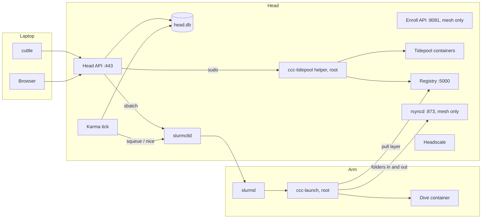
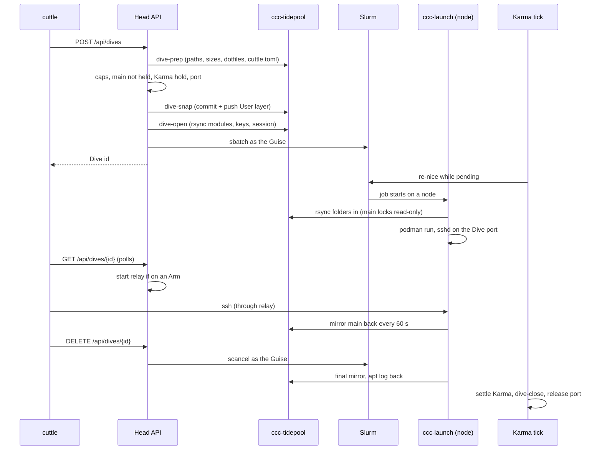

CCC is a [[Glossary#Head|Head]] that runs the control plane and holds everyone's files, plus any
number of [[Glossary#Arm|Arms]] that lend GPUs. Slurm does the scheduling, Podman runs every User
container, and a private WireGuard [[Glossary#Mesh|Mesh]] joins the machines. This page walks through
the parts, then follows one [[Glossary#Dive|Dive]] from start to finish.

## The parts



### On the Head

The Head runs a handful of systemd services. Unit names are in `cli/core/src/cuttle/config.py`.

| Service | What it does |
| --- | --- |
| `ccc-head-api` | The Head API (`ccc_head_api.main`). FastAPI under uvicorn on port 443, every address. Serves the JSON API under `/api`, the Dashboard SPA at `/`, and the wiki at `/wiki/`. Runs as `ccc`. |
| `ccc-enroll-api` | The Enroll API (`ccc_head_api.enroll`). Bound to the Head's mesh address only, port 8081. Hands a new Arm the munge key, registry login and image refs. Runs as `munge`. |
| `ccc-karma` | The Karma tick (`ccc_head_api.tick`). One pass every 30 seconds. |
| `ccc-tidepool@<user>` | One per User: keeps that User's Tidepool container running. |
| `ccc-rsyncd` | rsync daemon on the mesh address. Each Dive gets its own modules, added and removed by the helper. |
| `ccc-registry-push` / `-pull` | Two `registry:2` containers on one store. Push listens on 127.0.0.1, pull on the mesh address (read-only, one login per Arm). |
| `ccc-registry-gc.timer` | Nightly garbage collection of deleted Dive snapshots. |
| `slurmctld`, `slurmd` | Slurm. The Head is also a node, so Dives can land on its own GPUs. |
| `headscale`, `tailscaled-ccc` | The Mesh: Headscale as coordinator, plus CCC's own tailscaled on interface `ccc0`. |
| `ccc-backup.timer`, `ccc-monitor.timer` | Daily backup, and the Head-box health and rogue-GPU monitor. |

Two account names show up all over the code:

- **`ccc`** (called the *Mantle* in comments) is the cluster's own account. It runs the Head API and
  the tick, owns `head.db`, and can't read any Tidepool's files.
- **Guises** (`ccc-u<uid>`) are per-User Linux accounts that Slurm jobs run as. One per User, same
  uid on every node, created by the Slurm prolog. `ccc` may `sbatch`/`scancel` as a Guise, never as
  root (`headapi.install_slurm_sudoers`).

Anything that needs root goes through one of two small root helpers, both in
`cli/core/src/cuttle/` and installed to `/usr/local/sbin/` by setup:

- **`ccc-tidepool`** (`ccc_tidepool.py`) runs on the Head. It creates, restarts and resets Tidepools,
  prepares and closes Dives, and does the Dashboard's file operations. The Head API reaches it
  through sudoers rules that pin each verb to a regex (`templates.py`).
- **`ccc-launch`** (`ccc_launch.py`) runs on every node, inside a Slurm job. It starts that job's
  container. See [[Isolation]] for what it refuses.

### The Head API

All API routes live under `/api` so they never clash with the SPA's own paths (`/karma`, `/dive/4`).
A few routes are open at the root: `/healthz`, `/readyz`, `/ca.pem` and `/cluster-name`.

Sign-in gives you a session: a bearer token for the CLI, an HttpOnly cookie for the browser. Tokens
are stored hashed. Sessions minted *inside* a Tidepool or Dive (scope `tidepool` or `dive`, called
*ambient*) are never Admin and can only read, except to start and end their own Dives. The Head API
has no admin-write endpoints at all: `cuttle user …` and `cuttle karma …` run `ccc_head_api.admin` on
the Head, writing `head.db` directly.

Login and password changes are rate limited per username and per IP (`ratelimit.py`).

### head.db

One SQLite file at `/var/lib/ccc/head/head.db`, owned by `ccc`, mode 0600, WAL mode. Two writers: the
Head API and the tick. The schema lives in `db.py`, and it's version **26**. There's no migration
ladder: any other version is refused, and the fix is `cuttle teardown` then `cuttle setup --head`.

| Table | Holds |
| --- | --- |
| `users`, `sessions` | Accounts (argon2id passwords) and hashed session tokens with their scope. |
| `dives` | One row per Dive, keyed by Slurm job id. What was asked for (`minutes`, `gpus`, `vram_gb`), where it ran (`placed_node`), when it started and finished, `cancelled`, its `token`, `main`, `deps`, `port`, relay pid, and `closed`. Rows stay after the Dive for history. |
| `dive_ports` | Ports reserved before the job id exists. |
| `karma_ledger` | One row per Karma event. There's no balances table: a balance is a decayed sum over this. |
| `karma_escrow` | A running Dive's live claim: the `hold` quoted at start and what it has `accrued`. Deleted at settlement. |
| `karma_demand` | Demand samples per Arm, for the Tide forecast and charts. Kept 30 days. |
| `arm_retractions`, `retracted_jobs` | Arms taking no new Dives, and Dives caught by a Retract with their deadline. |
| `ssh_keys` | Users' public keys, written out to each Tidepool's `authorized_keys`. |
| `guises` | The uid allocator. A removed User's row stays so their uid is never reused. |

A Dive's outcome isn't stored. `dive.outcome()` works it out: **ended** if someone cancelled it,
**timed out** if it ran to within a minute of its time limit, otherwise **lost**. Slurm keeps no
accounting here (no slurmdbd), so run length is the only way to tell the last two apart.

### The Karma tick

Every 30 seconds `tick.once()` reads the queue and the Arms from Slurm and then, in order:

1. Samples Demand on every Arm.
2. Meters every running Dive, per card, at that card's Power.
3. Force-kills Retracted Dives past their deadline.
4. Settles every Dive that has left the queue (one ledger row, escrow deleted).
5. Records endings and closes finished Dives (`dive.reap_dead`).
6. Refreshes each Tidepool's ambient session.
7. Re-ranks pending Dives by setting each one's Slurm `nice` from its owner's standing.

Settlement works by absence: a Dive that's gone from a *successful* `squeue` has ended. If slurmctld
is down, the pass fails and nothing settles.

### The Dashboard

A React 19 + Vite + Tailwind SPA in `head/web/`. The router (`src/app/router.tsx`) is hand-written:
`/` queue, `/history`, `/arms`, `/karma`, `/tide`, `/files`, `/account`, `/users`, `/dive/<id>`.
The Head API serves the built `dist/` from `/opt/ccc/head-api/web` and falls back to `index.html` for
unknown extensionless paths, so a reload on `/karma` still works.

### The wiki

This wiki is Quartz, in `wiki/`. `cuttle setup --head` and `cuttle update` build it right after the
SPA (`setup.build_wiki`: `./setup.sh`, then `npx quartz build`) and copy `wiki/public/` to
`/opt/ccc/head-api/wiki`. The Head API serves it at `/wiki/` to anyone signed in. Without a session it
redirects to the Dashboard's sign-in, which sends you back afterwards.

### The Mesh and Arms

Every node runs CCC's own tailscaled (`tailscaled-ccc`, interface `ccc0`) against the Head's
Headscale. Users' laptops aren't on the Mesh. They reach the Head on its normal address.

An Arm joins like this: an Admin runs `cuttle arm authorize <name> --user <owner>` on the Head, which
records the Arm and mints a join token. The donor runs `cuttle setup --arm --token <token>`. The box
joins the Mesh, calls `/enroll` on the mesh-only Enroll API, gets the munge key, a registry login and
the image digests, pulls the base image, benchmarks its GPUs in Podman, and starts `slurmd`.

### The containers

Every User container is rootful Podman with its own unprivileged ID range, started from one base
image built on the Head (Ubuntu 24.04, Python 3.12 + uv, no Python packages). A User's own changes,
like apt installs, live in a per-User layer on top. For a Dive, that layer is committed, pushed to
the Head registry and pulled by the node running the Dive. The base layer is already there, so only
the User's layer travels. [[Isolation]] covers the details.

## The life of a Dive

Say you run `cuttle dive start projects/fractals --gpus 1 --vram 16 --time 2h`.



### 1. Request

`POST /api/dives` (`dive.request`) does everything up front, while the CLI waits:

1. **Prep.** The helper's `dive-prep` checks the folder paths (relative, no `..`, no symlinked
   components), measures what would be staged with an rsync dry run as the User, copies the dotfile
   allowlist aside, and reads `cuttle.toml` from the main folder.
2. **Settings and checks.** `cuttle.toml` merged with the request's args (args win). Refused if over
   25 GB in total or 1 GB of dotfiles, or if another open Dive holds the same main folder (409).
   Retracted Arms go in `--exclude`; VRAM and Features become a Slurm `--constraint`.
3. **Karma hold** quoted (`karma.quote_hold`), Guise allocated, a port reserved from 31000–31199.
4. **Snapshot.** `dive-snap` commits the Tidepool container and pushes it as `ccc/u-<user>:<token>`.
5. **Open.** `dive-open` writes `cuttle.toml` back if the args changed it, stages the host key,
   authorized keys and the Dive's ambient session, and adds the per-Dive rsyncd modules.
6. **Submit.** `sbatch` as the Guise. The job script is one line, `sudo -n ccc-launch
   $SLURM_JOB_ID`, plus a `# ccc-launch-spec:` comment carrying the spec. The row goes into `dives`
   and `karma_escrow`.

If any step fails, the job is cancelled, `dive-close` runs, the session is revoked and the port
released.

### 2. Queue and placement

Slurm decides where and when. While the Dive is pending, the tick sets its `nice` from your Karma
standing, so people who've used less go first. When Slurm starts the job, it can land on any node
that fits, the Head included. Head Dives and Arm Dives take exactly the same path.

### 3. Launch

On the node, `ccc-launch` checks it was really called from inside that job, reads the spec back from
slurmctld (not from its arguments), and then pulls from the Head's rsyncd, in order: the `sys` bundle,
dotfiles, dep folders, and the main folder last. The first pull of the main module runs the helper's
`dive-lock`, which bind-mounts the main folder read-only inside the Tidepool. Then it starts the Dive
container with the User's snapshot, only the job's GPUs, and sshd on the Dive port. It also writes a
banner line and the "in a dive" prompt info, and the container builds the env file into `.venv` in the
background if you gave one.

### 4. Attach

`cuttle dive attach` polls `GET /api/dives/{id}`. For an Arm Dive, the first poll after it's running
starts a relay (`relay.py`, a plain TCP forwarder) on the Head at the Dive's port, pointing at the
Arm's mesh address. A Head Dive publishes the port itself, so no relay. The Dive counts as ready once
an SSH banner answers. You then `ssh <cluster>-<id>` with your own key, and the host key is your
Tidepool's.

### 5. Sync back

Every 60 seconds `ccc-launch` mirrors the main folder back to the Tidepool with `rsync --delete`
(skipping `.venv`, caches and `.cuttleignore` matches). Dep folders and dotfiles are read-only and
never come back.

### 6. End

`cuttle dive end` sends `DELETE /api/dives/{id}`, which `scancel`s as the Guise and marks the row
cancelled. Running out of time ends it the same way. SIGTERM reaches the container; when it stops,
`ccc-launch` does a final mirror (up to three tries) inside Slurm's `KillWait` of 600 seconds, copies
the apt history out of the container to the Head, removes the container and deletes the image. The
epilog's `podman rm -f` backs that up if the job is killed hard.

### 7. Close and outcome

On its next pass the tick notices the job is gone. It settles the Karma (a Retract-caught Dive
settles at zero), stamps `finished_at`, kills the relay, and runs `dive-close`: lock lifted, rsync
modules removed, snapshot manifest deleted from the registry, apt replay into the Tidepool started.
The port is released and the row marked `closed`. History then shows the outcome: ended, timed out,
or lost.

## Repo layout

| Path | What's there |
| --- | --- |
| `cli/core/src/cuttle/` | The `cuttle` CLI and nearly all provisioning: `setup.py`, `teardown.py`, `mesh.py`, `podman.py`, `templates.py` (every rendered config and unit), plus the root helpers `ccc_tidepool.py`, `ccc_launch.py` and `cdi_patch.py`. Arm-side code lives here too. |
| `head/api/src/ccc_head_api/` | The Head API, Enroll API, Karma tick, relay, admin CLI, and `db.py`. |
| `head/web/` | The Dashboard SPA. |
| `wiki/` | This wiki. Pages in `wiki/content/`. |
| `tests/` | The pytest suite for both Python packages. |
| `examples/` | Example projects. |
| `arm/`, `karma/`, `telemetry/`, `shared/` | Each holds a `CONTEXT.md` (and some a `setup/README.md`) for that area. Their code lives in `cli/` and `head/`. |
| `CONTEXT.md` | The project's glossary, the authority on what each term means. |
| `docs/` | The old 1.x docs. Being replaced by this wiki. |

`cuttle` and `ccc-head-api` are two separate Python packages. The root `pyproject.toml` is a virtual uv
project that installs both into one venv, only so the tests can see both sides at once.

## Working on it

### Tests

From the repo root:

```bash
uv run pytest -q -p no:warnings
```

The suite needs no Slurm, sudo, GPU or real database. It tests what renders (config files, units, job
scripts, HTTP responses) and the logic around it, with system calls faked. `tests/fake_cluster.py`
is an in-memory Slurm for running the real Karma economy over simulated weeks. What earns a test is in `tests/TESTING.md`: a test has to name a consequence that
would otherwise show up later on someone else's machine. Assert on parsed structure, not substrings.

Anything that needs real boxes goes on the hardware test list (see [[Roadmap]]).

### Dashboard

```bash
cd head/web
npm ci
npm run dev        # Vite on :5173, proxies /api to https://localhost
npm run typecheck
npm run build      # what setup runs
```

### Wiki

```bash
cd wiki
./setup.sh                         # once: fetches Quartz at a pinned commit
npx quartz build --serve           # http://localhost:8080
npx quartz build && python3 check_links.py   # check for broken links
```

Stop a running `--serve` before a separate build, since both write `wiki/public/`. Page rules and
the template are in the `## Wiki` section of the repo's `CLAUDE.md`.

### Conventions

- **Commits** are Conventional Commits, `type(scope): subject`, short and lowercase. One logical
  change per commit. Wiki changes go in their own commits, separate from code.
- **Rebase, never merge.** Work on a branch and rebase onto `main`. No pull requests.
- Try a change on a real box with `cuttle update`. Full `cuttle teardown --all` + `cuttle setup
  --head` is the normal way to redeploy a test Head.

## Related
- [[Contributing/index|Contributing]]: parent
- [[Isolation]]: how the containers, accounts and network are fenced
- [[Roadmap]]: what's being built next
- [[Glossary]]: what the terms mean
